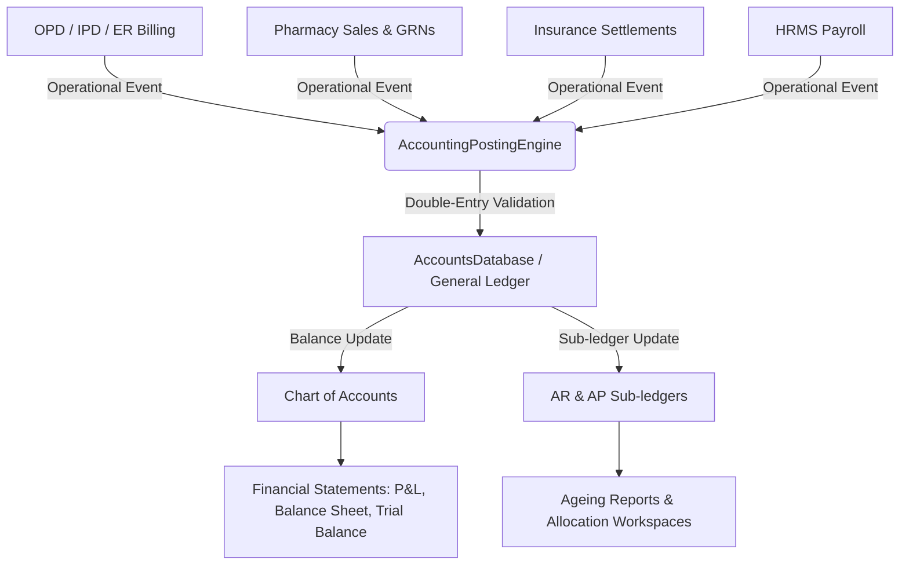

# HospAI Enterprise HMS — Accounts & Financial Management System Documentation

## 1. Overview
The HospAI Accounts & Finance module provides double-entry accounting, real-time Chart of Accounts management, General Ledger posting, AR/AP sub-ledger tracking, Cashier Handover auditing, Indian GST calculation, Cost Centre budgeting, Fixed Asset depreciation, and Financial Statement generation (Balance Sheet, P&L, Trial Balance).

---

## 2. Architecture & Data Flow

---

## 3. Core Capabilities Implemented

### 3.1 Chart of Accounts (COA)
- 5 Standard Account Categories: Asset (1000s), Liability (2000s), Equity (3000s), Revenue (4000s), Expense (5000s).
- Hierarchical account structure with numeric codes, control accounts, and normal debit/credit balances.

### 3.2 Double-Entry Journal Engine
- Strict Debit/Credit balancing enforcement ($\sum \text{Debits} = \sum \text{Credits}$).
- Immutable posted journals with audit trail.
- Controlled journal reversal with linked reference (`reversal_of_journal_id`).

### 3.3 Accounts Receivable (AR) & Accounts Payable (AP)
- AR Sub-ledger tracking Patient, Corporate, and Insurance receivables.
- 4-Tier Ageing Analysis (0-30 days, 31-60 days, 61-90 days, 90+ days).
- Receipt allocation workspace.
- AP Sub-ledger tracking supplier trade invoices, GRN matching, and payment vouchers.

### 3.4 Cash & Bank Management
- Billing Counter Cash Closing & Cashier Shift Handover audit register.
- Variance detection (`actual_cash_counted - system_collections`).
- Bank Account balances & statement reconciliation.

### 3.5 Indian GST Framework
- GSTIN setup, Place of Supply configuration.
- CGST, SGST, IGST rates.
- Eligible Input Tax Credit (ITC) classification vs Output Tax Liabilities.

### 3.6 Cost Centre Budgeting & Fixed Assets
- Departmental Cost Centres (OPD, IPD, ER, Lab, Radiology, Pharmacy, OT, ICU, Admin).
- Annual vs Actual YTD Variance & Utilization %.
- Fixed Asset Register with Useful Life & Monthly Depreciation Engine (SLM / WDV).

### 3.7 Financial Statements
- **Balance Sheet**: Assets = Liabilities + Equity invariant validation.
- **Profit & Loss (P&L)**: Operating Revenue vs Operating Expenses & Net Operating Margin.
- **Trial Balance**: Complete Debit vs Credit ledger balance verification.
- Export to CSV format.

---

## 4. Key Code Locations

- Types: [`src/types/accounts.ts`](file:///home/kalpra/Desktop/GNANESH/Enterprise-Hospital-Management-System/src/types/accounts.ts)
- Engine & COA: [`src/services/accountsDb.ts`](file:///home/kalpra/Desktop/GNANESH/Enterprise-Hospital-Management-System/src/services/accountsDb.ts)
- Integration Adapter: [`src/services/accountingPostingEngine.ts`](file:///home/kalpra/Desktop/GNANESH/Enterprise-Hospital-Management-System/src/services/accountingPostingEngine.ts)
- Views: [`src/components/accounts/`](file:///home/kalpra/Desktop/GNANESH/Enterprise-Hospital-Management-System/src/components/accounts/)
- Main Container: [`src/components/AccountsModule.tsx`](file:///home/kalpra/Desktop/GNANESH/Enterprise-Hospital-Management-System/src/components/AccountsModule.tsx)
- Express Router: [`server/routes/accounts.mjs`](file:///home/kalpra/Desktop/GNANESH/Enterprise-Hospital-Management-System/server/routes/accounts.mjs)
